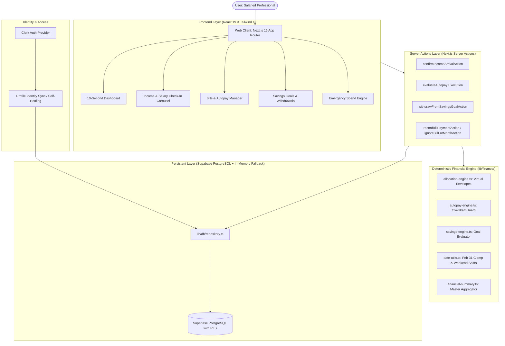

# Salary Day Autopilot

> **Your salary. Your bills. Your month. On autopilot.**
> 
> *A deterministic, zero-hallucination fintech autopilot engine built for early-career salaried professionals to answer two critical questions in under 10 seconds:*
> 1. **Am I financially okay this month?**
> 2. **What should I do next?**

[](https://nextjs.org/)
[](https://react.dev/)
[](https://www.typescriptlang.org/)
[](https://tailwindcss.com/)
[](https://supabase.com/)
[](https://clerk.com/)
[](https://vitest.dev/)

---

## 📑 Table of Contents

- [1. Executive Summary](#1-executive-summary)
- [2. System Architecture](#2-system-architecture)
- [3. Deterministic Financial Calculation Engine](#3-deterministic-financial-calculation-engine)
- [4. Complete Feature Catalog](#4-complete-feature-catalog)
  - [4.1 10-Second Decision Dashboard](#41-10-second-decision-dashboard)
  - [4.2 Dynamic Income & Salary Check-In Carousel](#42-dynamic-income--salary-check-in-carousel)
  - [4.3 Virtual Money Envelopes & Hierarchy](#43-virtual-money-envelopes--hierarchy)
  - [4.4 Smart Autopay Engine with Overdraft Protection](#44-smart-autopay-engine-with-overdraft-protection)
  - [4.5 Configurable Savings Goals & Emergency Withdrawals](#45-configurable-savings-goals--emergency-withdrawals)
  - [4.6 Bills & Payment Management (Partial Payments & Ignore)](#46-bills--payment-management-partial-payments--ignore)
  - [4.7 Emergency & Surprise Spend Calculator](#47-emergency--surprise-spend-calculator)
  - [4.8 Credit Card Liability Management](#48-credit-card-liability-management)
  - [4.9 Authentic Clerk Identity Sync](#49-authentic-clerk-identity-sync)
  - [4.10 Complete Audit Log & Traceability](#410-complete-audit-log--traceability)
- [5. Mandatory Hackathon Edge Cases Handled](#5-mandatory-hackathon-edge-cases-handled)
- [6. Database Schema & Supabase Migrations](#6-database-schema--supabase-migrations)
- [7. Technology Stack](#7-technology-stack)
- [8. Automated Test Suite (Vitest)](#8-automated-test-suite-vitest)
- [9. Setup & Deployment Guide](#9-setup--deployment-guide)

---

## 1. Executive Summary

Early-career salaried professionals (such as Arjun, a 24-year-old software engineer in Chennai earning ₹45,000/month, or Amish earning ₹60,000/month) frequently suffer from the "Salary Day Illusion": seeing a large bank balance on payday and inadvertently spending it, only to face an overdraft when critical EMIs, rent, or annual bike insurance come due later in the month.

Traditional personal finance apps fail because they require tedious manual transaction tagging, display confusing retro-graphs, or rely on non-deterministic LLMs that hallucinate financial calculations.

**Salary Day Autopilot** eliminates this cognitive load. By running a deterministic priority allocation engine, it partitions liquid bank balances into **Virtual Money Envelopes**, protects essential rent and EMI obligations, executes automated bill settlements safely, and displays the exact **Safe Discretionary Allowance (Per-Day & Monthly)** in plain English and Indian Rupees.

---

## 2. System Architecture



---

## 3. Deterministic Financial Calculation Engine

All core financial calculations reside in `lib/finance/`. The platform guarantees:

1. **Zero LLM Hallucinations in Financial Calculations**: LLMs are never used for arithmetic, allocations, shortfalls, or balances. All mathematics is strictly algorithmic and deterministic.
2. **Integer Paise Representation**: All internal monetary values are stored as 64-bit integers in **paise** (1 Rupee = 100 paise). This prevents floating-point IEEE-754 precision bugs (e.g., `0.1 + 0.2 !== 0.3`).
3. **Indian Currency Formatting**: Outputs are formatted using Indian number clustering via `formatRupees()` (e.g., `₹45,000`, `₹1,20,000`, `₹60,00,000`).
4. **Timezone Safety**: Dates and monthly cycles are normalized to `Asia/Kolkata` (IST) without client-server date drift.

---

## 4. Complete Feature Catalog

### 4.1 10-Second Decision Dashboard
- **Financial Health Badge**: Instantly displays `Healthy` (green), `Needs Attention` (amber), or `Critical` (red) with human-readable rationale.
- **Available to Spend**: The hero card displays the exact safe discretionary cash (`₹17,000` or `₹566/day`), automatically deducted for upcoming essential bills and planned savings.
- **Your Next Action**: High-priority alert telling the user the single most urgent task (e.g., *"Pay your House Rent of ₹20,000 by day 1"*).
- **Virtual Envelopes Visualizer**: Progress bars indicating liquidity allocations for Housing, Debt, Family, Utilities, Food/Transport, Reserves, and Savings.

### 4.2 Dynamic Income & Salary Check-In Carousel
- **Monthly Check-In Prompt**: On or around salary day, prompts: *"Have you received your full salary of ₹60,000 for this month?"*
- **Multi-Source Carousel**: Cycles through all user income streams (Primary Salary, Roommate Share, Freelancing, Part-time Tutoring).
- **One-Click Affirmation**: *"✓ Yes, Received Full ₹60,000"*.
- **Adjusted Amount Modal**:
  - Unpaid leave deduction (e.g. 3 days unpaid leave automatically calculated).
  - Festival / Diwali bonus presets (+20%).
  - Custom amount entry (e.g., entered ₹4,500 instead of ₹5,000 for Part-time Tutoring).
- **Session Dismissal (Skip)**: Hides the check-in for the current session without marking it received; reappears upon reload.
- **Real-Time Rebalancing**: Shortfalls automatically reduce flexible spending and pause non-essential savings, safeguarding rent and EMIs.

### 4.3 Virtual Money Envelopes & Hierarchy
Funds are partitioned virtually without locking money in external bank accounts:
1. **Critical Obligations**: Rent, Home Loan / Bike EMIs.
2. **Essential Family Support**: Transfers to parents/dependents.
3. **Utilities & Connectivity**: Electricity, Wi-Fi, Water.
4. **Essential Commute & Groceries**: Baseline food and transit.
5. **Credit Card Liabilities**: Outstanding card balances to avoid interest charges.
6. **Annual Sinking Reserves**: Monthly amortized reserves for future lump-sum bills (e.g. Bike Insurance in February).
7. **Savings Goals**: Active financial milestones (e.g. "Savings for future").
8. **Discretionary Allowance**: Safe spending for weekends, shopping, and dining.

### 4.4 Smart Autopay Engine with Overdraft Protection
- **Configurable Autopay Toggle**: User can enable/disable Autopay per bill in Bills & Payments or during Onboarding.
- **Deterministic Overdraft Protection (`lib/finance/autopay-engine.ts`)**:
  - Checks if `bill.due_date <= current_day + 2`.
  - Verifies bank balance has sufficient funds without breaching critical priority thresholds.
  - Automatically settles eligible bills, records bank debit transactions, and updates profile balance.
  - Skips bills safely if funds are insufficient, preventing negative balances.

### 4.5 Configurable Savings Goals & Emergency Withdrawals
- **Dynamic Dashboard Goal**: Dynamically displays the user's primary active goal (e.g. **"Savings for future"**, `₹0 of ₹60,000`, `0%`), eliminating hardcoded placeholders.
- **Monthly Savings Target**: User can configure a monthly contribution target (e.g., ₹2,000/month).
- **Save Extra Funds**: Deposit surplus flexible spending into savings milestones.
- **Emergency "Take Out Funds"**: Withdraw money from savings back into the bank balance to cover pending bills.
  - Automatically calculates pending bill shortfalls and highlights the exact amount needed.
  - Warns the user of deadline impacts while keeping bills afloat.

### 4.6 Bills & Payment Management (Partial Payments & Ignore)
- **Due Date Customization**: Set specific calendar due dates (1st through 31st).
- **Partial Payment Support**: Log partial transfers (e.g., sent ₹3,000 of ₹5,000 family transfer); tracks remaining ₹2,000.
- **"Ignore for this Month"**: 3-dot dropdown menu option to disregard a bill for the current cycle, removing it from upcoming obligations and freeing up discretionary money.
- **Bill Editing & Deletion**: Manage recurring bills, priorities, and autopay status.

### 4.7 Emergency & Surprise Spend Calculator
- **Modal Input**: Accessible via "+ Surprise / Emergency Spend" on the dashboard.
- **Impact Simulation**: Pre-populates common scenarios (e.g., ₹12,000 Father's Health Checkup & Hospital Visit).
- **Protected Reserve Alert**: If the spend exceeds discretionary money, alerts the user of the exact deficit and lists which protected bills/savings would be compromised.

### 4.8 Credit Card Liability Management
- **Liability vs Outflow**: Card purchases are treated as deferred liabilities, not direct bank deductions.
- **Settlement Tracking**: Recording a credit card bill settlement deducts the bank balance and clears the liability envelope without double-counting.

### 4.9 Authentic Clerk Identity Sync
- **Clerk Authentication**: Full email and social sign-in support via `@clerk/nextjs`.
- **Identity Self-Healing**: Automatically synchronizes the user's authentic Clerk name (e.g. Amish Sharma) with the database profile, eliminating default placeholders.

### 4.10 Complete Audit Log & Traceability
- Every budget adjustment, salary shortfall, partial bill payment, and autopay execution creates a persistent, human-readable audit log on `/activity` with timestamp, previous state, new state, and actionable explanations.

---

## 5. Mandatory Hackathon Edge Cases Handled

| Edge Case | Problem | Autopilot Solution | Tested In Vitest |
| :--- | :--- | :--- | :---: |
| **Case 1: Salary Arrives Short** | Salary ₹8,000 lower than expected (e.g. ₹37,000 vs ₹45,000). | Automatically trims flexible daily spend and pauses optional savings; 100% preserves Rent and Bike EMI. | ✅ Pass |
| **Case 2: 31st Due Date in Short Month** | Recurring bill due on the 31st during February or April. | `clampDueDateToMonth()` clamps February 31st to 28th (or 29th in leap years) and April 31st to 30th without modifying master model. | ✅ Pass |
| **Case 3: Emergency Exceeds Discretionary Cash** | ₹12,000 hospital checkup with only ₹3,000 flexible money. | Calculates exact ₹9,000 deficit, generates loud visual warnings before touching essential reserves, and requires explicit user consent. | ✅ Pass |
| **Weekend / Holiday Shift** | Salary date (e.g. 7th) falls on a Saturday, Sunday, or gazetted holiday. | `getAdjustedSalaryDate()` shifts projected arrival to the next banking business day. | ✅ Pass |
| **Roommate Income Isolation** | Expected ₹3,000 roommate split on the 15th. | Strictly excluded from available spending until user marks it confirmed/received. | ✅ Pass |
| **Variable / Changed Income** | Income received is different from expected (₹4,500 vs ₹5,000). | Updates received amount across dashboard verified bar, Income Sources table, and monthly budget calculations. | ✅ Pass |

---

## 6. Database Schema & Supabase Migrations

The database schema utilizes Supabase PostgreSQL with Row Level Security (RLS) policies:

```sql
-- Profiles table
CREATE TABLE IF NOT EXISTS profiles (
  id TEXT PRIMARY KEY,
  user_id TEXT NOT NULL UNIQUE,
  full_name TEXT NOT NULL,
  city TEXT DEFAULT 'Chennai',
  currency TEXT DEFAULT 'INR',
  monthly_salary BIGINT NOT NULL,          -- in paise
  salary_date INT NOT NULL DEFAULT 7,
  salary_frequency TEXT DEFAULT 'monthly',
  current_balance BIGINT NOT NULL,         -- in paise
  salary_received_this_month BOOLEAN DEFAULT false,
  onboarding_completed BOOLEAN DEFAULT true,
  created_at TIMESTAMPTZ DEFAULT NOW(),
  updated_at TIMESTAMPTZ DEFAULT NOW()
);

-- Bills table
CREATE TABLE IF NOT EXISTS bills (
  id TEXT PRIMARY KEY,
  user_id TEXT NOT NULL REFERENCES profiles(user_id) ON DELETE CASCADE,
  name TEXT NOT NULL,
  amount BIGINT NOT NULL,                  -- in paise
  paid_amount BIGINT DEFAULT 0,            -- in paise
  due_date INT NOT NULL,
  recurrence TEXT DEFAULT 'monthly',
  annual_month INT,
  category TEXT NOT NULL,
  priority TEXT NOT NULL,                  -- 'critical' | 'essential' | 'discretionary'
  is_paid BOOLEAN DEFAULT false,
  paid_date TIMESTAMPTZ,
  is_ignored BOOLEAN DEFAULT false,
  autopay BOOLEAN DEFAULT false,
  notes TEXT,
  created_at TIMESTAMPTZ DEFAULT NOW()
);

-- Savings Goals table
CREATE TABLE IF NOT EXISTS savings_goals (
  id TEXT PRIMARY KEY,
  user_id TEXT NOT NULL REFERENCES profiles(user_id) ON DELETE CASCADE,
  title TEXT NOT NULL,
  target_amount BIGINT NOT NULL,           -- in paise
  current_amount BIGINT DEFAULT 0,         -- in paise
  monthly_contribution BIGINT DEFAULT 0,   -- in paise
  target_date TEXT NOT NULL,
  is_paused BOOLEAN DEFAULT false,
  priority INT DEFAULT 1,
  notes TEXT,
  created_at TIMESTAMPTZ DEFAULT NOW()
);

-- Income Sources table
CREATE TABLE IF NOT EXISTS income_sources (
  id TEXT PRIMARY KEY,
  user_id TEXT NOT NULL REFERENCES profiles(user_id) ON DELETE CASCADE,
  name TEXT NOT NULL,
  amount BIGINT NOT NULL,                  -- in paise
  expected_date INT NOT NULL,
  frequency TEXT DEFAULT 'monthly',
  is_variable BOOLEAN DEFAULT false,
  status TEXT DEFAULT 'expected',          -- 'expected' | 'received' | 'overdue'
  received_amount BIGINT,                  -- in paise
  received_date TIMESTAMPTZ,
  received_month TEXT,
  notes TEXT,
  created_at TIMESTAMPTZ DEFAULT NOW()
);
```

---

## 7. Technology Stack

- **Framework**: Next.js 16.4.3 (Turbopack, App Router, Server Actions)
- **UI & State**: React 19.3.0, Lucide React icons
- **Styling**: Tailwind CSS 4, Custom dark fintech color palette (`#0f172a`, emerald highlights)
- **Database**: Supabase PostgreSQL with fallback in-memory repository
- **Authentication**: Clerk (`@clerk/nextjs`)
- **Date Engine**: `date-fns` with custom Indian financial calendar utilities
- **Testing Engine**: Vitest 5.0.5

---

## 8. Automated Test Suite (Vitest)

Run all unit tests locally:
```bash
npm test
```

Test coverage includes:
1. `formats Indian Rupees correctly in Indian number format`
2. `Edge Case 2: Clamps bill due on 31st in February to 28 or 29 without crashing`
3. `Weekend Salary Date: Shifts Saturday/Sunday salary dates to next business day`
4. `Edge Case 1: Detects salary shortfall of ₹8,000 and calculates adjustments`
5. `Autopilot Allocation: 100% Protects rent & bike EMI during ₹8,000 shortfall`
6. `Integrity Rule: Expected income is NOT counted as available cash before arrival`
7. `Edge Case 3: Analyzes ₹12,000 emergency with only ₹3,000 available`
8. `Credit Card: Liability tracked separately from direct bank debit`
9. `Credit Card: Settling bill clears liability without double counting`
10. `Bill Scheduler: Accurately schedules and orders bills by due date`
11. `Bill Scheduler: Identifies annual bills in their non-due months`
12. `Autopay Engine: Automatically pays eligible bills before due date when balance is sufficient`
13. `Autopay Engine: Skips autopay when balance is insufficient (Overdraft Protection)`
14. `Savings Engine: Honors configured monthly savings target`
15. `Financial Summary: Dynamically populates custom savings goal title and progress`
16. `Salary Calculator & Breakdown: Honors modified received amount (₹4,500) over expected (₹5,000)`
17. `Autopay Overdraft Integrity Guard`

---

## 9. Setup & Deployment Guide

### Local Development
```bash
# Clone the repository
git clone https://github.com/amish2005/Salary-Day-Autopilot.git
cd Salary-Day-Autopilot

# Install dependencies
npm install

# Run Vitest test suite
npm test

# Start Next.js development server
npm run dev
```

### Vercel Deployment
1. Import **`https://github.com/amish2005/Salary-Day-Autopilot`** into **Vercel**.
2. Configure the following environment variables in **Project Settings > Environment Variables**:

| Variable | Description |
| :--- | :--- |
| `NEXT_PUBLIC_CLERK_PUBLISHABLE_KEY` | Clerk Publishable Key (`pk_test_...`) |
| `CLERK_SECRET_KEY` | Clerk Secret Key (`sk_test_...`) |
| `NEXT_PUBLIC_CLERK_SIGN_IN_URL` | `/sign-in` |
| `NEXT_PUBLIC_CLERK_SIGN_UP_URL` | `/sign-up` |
| `NEXT_PUBLIC_CLERK_AFTER_SIGN_IN_URL` | `/dashboard` |
| `NEXT_PUBLIC_CLERK_AFTER_SIGN_UP_URL` | `/onboarding` |
| `NEXT_PUBLIC_SUPABASE_URL` | Supabase Project URL (`https://...supabase.co`) |
| `NEXT_PUBLIC_SUPABASE_ANON_KEY` | Supabase Anon Public Key |
| `SUPABASE_SERVICE_ROLE_KEY` | Supabase Service Role Secret Key |

3. Click **Deploy**. Vercel will install dependencies via `.npmrc` (`legacy-peer-deps=true`), run Turbopack optimization, and deploy your live URL.
